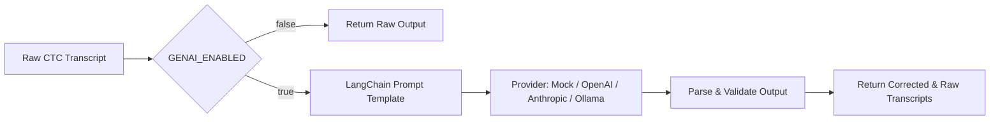

# LipRead — System Architecture

**LipRead** is a production-oriented visual speech recognition system designed to transcribe sentence-level spoken English from silent video sequences of human lip movements.

---

## 1. High-Level System Architecture

The following diagram illustrates the complete end-to-end dataflow from user input through video processing, neural inference, and optional lexical post-processing:

```mermaid
flowchart TD
    User([User / Client]) -->|Upload Video| Streamlit[Streamlit Frontend Web App]
    Streamlit -->|HTTP Multipart POST /predict| FastAPI[FastAPI REST Backend]
    
    subgraph API_Pipeline["FastAPI Service Layer"]
        FastAPI --> InputVal[Input Validation & Size Clamping]
        InputVal --> TempFile[Secure Temporary Video Buffer]
    end

    subgraph Preprocessing_Pipeline["Video Preprocessing (OpenCV + MediaPipe)"]
        TempFile --> VideoReader[OpenCV VideoReader: Extract Frames]
        VideoReader --> FaceLandmarks[MediaPipe FaceMesh: 478 3D Landmarks]
        FaceLandmarks --> LipROI[Mouth ROI Bounding Box Extractor]
        LipROI --> CropResize[Crop, Grayscale & Resize to 88x88]
        CropResize --> Normalize[Pixel Normalization [0, 1]]
        Normalize --> SeqBuilder[Sequence Builder: Fixed 75 Frames]
        SeqBuilder --> TensorOut["Tensor Shape: [1, 75, 1, 88, 88]"]
    end

    subgraph Neural_Inference["Deep Learning Model (PyTorch)"]
        TensorOut --> CNN3D["3D CNN (Spatiotemporal Feature Extraction)"]
        CNN3D --> SpatialPool["Adaptive Spatial Max Pooling -> [1, 75, 96]"]
        SpatialPool --> BiLSTM["2-Layer Bi-LSTM -> [1, 75, 512]"]
        BiLSTM --> LinearClassifier["Linear Projection -> [1, 75, 30]"]
        LinearClassifier --> CTCLogits["CTC Log-Softmax Layout [75, 1, 30]"]
    end

    subgraph Decoding_and_GenAI["Decoding & Post-Processing"]
        CTCLogits --> CTCDecode["CTC Decoding (Greedy / Prefix Beam)"]
        CTCDecode --> RawTranscript["Raw Acoustic Transcript"]
        RawTranscript --> GenAICheck{LLM Correction Enabled?}
        GenAICheck -->|Yes| LangChain[LangChain Contextual Corrector]
        GenAICheck -->|No / Fallback| ResponseFormatter[Format JSON Response]
        LangChain --> CorrectedTranscript[Corrected Lexical Transcript]
        CorrectedTranscript --> ResponseFormatter
    end

    ResponseFormatter -->|JSON Output| FastAPI
    FastAPI -->|HTTP 200 OK| Streamlit
    Streamlit -->|Display Results & Video| User
```

---

## 2. Video Preprocessing Pipeline

The video preprocessing pipeline transforms unconstrained raw video files into standardized 5D tensor sequences ready for batching and model execution.

```mermaid
flowchart LR
    A[Raw Video File] --> B[OpenCV VideoCapture]
    B --> C[Extract Frames]
    C --> D[MediaPipe FaceMesh]
    D --> E[Detect Lips: 40 Landmarks]
    E --> F[Compute Dynamic Bounding Box]
    F --> G[Grayscale & Resize 88x88]
    G --> H[Normalize to [0.0, 1.0]]
    H --> I[Temporal Padding / Truncation]
    I --> J["Fixed [75, 1, 88, 88]"]
```

### Preprocessing Specifications
- **Temporal Sequence Length:** Exactly **75 frames** (at 25 FPS, representing 3.0 seconds).
  - Sequences $> 75$ frames are center-truncated.
  - Sequences $< 75$ frames are edge-padded (or zero-padded if empty).
- **Spatial Resolution:** **88 $\times$ 88 pixels**.
- **Color Channels:** **1 (Grayscale)**, computed via luminance conversion (`0.299 R + 0.587 G + 0.114 B`).
- **Pixel Value Range:** Floating point `[0.0, 1.0]`.
- **Landmark Anchors:** 40 specific mouth indices from MediaPipe FaceMesh (upper lip, lower lip, corners, and inner contours).
- **Fallback Mechanism:** If a face is momentarily obscured or undetected, the extractor smoothly falls back to the center-crop heuristic without crashing.

---

## 3. Neural Model Architecture

The neural network implementation is composed of a spatiotemporal front-end, a bidirectional recurrent sequence modeling back-end, and a Connectionist Temporal Classification (CTC) head.

### Implemented Model Specifications
- **Total Parameter Count:** **2,541,310 parameters** (100% trainable).
- **Input Tensor Layout:** `[Batch, 75, 1, 88, 88]`

```
==========================================================================================
Layer (type:depth-idx)                   Output Shape              Param #
==========================================================================================
LipReadModel                             [B, 75, 30]               --
├─SpatiotemporalCNN3D: 1-1               [B, 75, 96]               --
│    └─Conv3d (Block 1)                  [B, 32, 75, 88, 88]       896
│    └─BatchNorm3d                       [B, 32, 75, 88, 88]       64
│    └─ReLU                              [B, 32, 75, 88, 88]       --
│    └─MaxPool3d (spatial only 1x2x2)    [B, 32, 75, 44, 44]       --
│    └─Conv3d (Block 2)                  [B, 64, 75, 44, 44]       55,360
│    └─BatchNorm3d                       [B, 64, 75, 44, 44]       128
│    └─ReLU                              [B, 64, 75, 44, 44]       --
│    └─MaxPool3d (spatial only 1x2x2)    [B, 64, 75, 22, 22]       --
│    └─Conv3d (Block 3)                  [B, 96, 75, 22, 22]       165,984
│    └─BatchNorm3d                       [B, 96, 75, 22, 22]       192
│    └─ReLU                              [B, 96, 75, 22, 22]       --
│    └─MaxPool3d (spatial only 1x2x2)    [B, 96, 75, 11, 11]       --
│    └─AdaptiveAvgPool3d (1x1x1 spatial) [B, 75, 96]               --
├─BiLSTMLayer: 1-2                       [B, 75, 512]              --
│    └─LSTM (2 layers, bidirectional)    [B, 75, 512]              2,315,776
├─Dropout (p=0.2)                        [B, 75, 512]              --
├─Linear (Classifier Head)               [B, 75, 30]               15,390
==========================================================================================
Total params: 2,541,310
Trainable params: 2,541,310
Non-trainable params: 0
==========================================================================================
```

### Architectural Key Points
1. **Preservation of Temporal Granularity:** The MaxPool3D layers use spatial-only pooling kernels `(1, 2, 2)`. The temporal dimension is strictly preserved at $T=75$ throughout the convolutional feature extractor.
2. **Bidirectional Temporal Modeling:** The 2-layer Bi-LSTM with hidden size 256 per direction produces a forward-backward fused feature representation of 512 units per timestep.
3. **Vocabulary & CTC Output:** Linear projection maps 512 units to 30 character classes (Index 0 = `<blank>`, Index 1 = `' '` space, Indices 2–27 = `a`–`z`, Index 28 = `'` apostrophe).

---

## 4. CTC Decoding Layer

The model outputs logits over time `[T, B, V]`. LipRead supports two decoding strategies:

1. **Greedy CTC Decoding (Default):**
   - For each timestep $t \in [1..75]$, selects $c_t = \arg\max_k P(k | x_t)$.
   - Collapses consecutive duplicate characters: `a a a b b -> a b`.
   - Removes CTC blank tokens (index 0).
   - *Characteristics:* Extremely fast ($< 1$ ms), highly stable.
2. **Prefix Beam Search Decoding (Experimental):**
   - Maintains top-$K$ candidate prefixes across timesteps.
   - Sums probabilities across blank and non-blank alignment paths.
   - *Current Status:* Unconstrained prefix beam search without an external language model does not outperform greedy decoding on our current checkpoint; greedy remains the default production decoder.

---

## 5. Optional LLM Post-Processing (LangChain)

For cases where acoustic visual ambiguities occur (such as visually indistinct phonemes/visemes like `p`/`b`/`m`), an optional LLM-based post-processing layer can be enabled via configuration.



- **Safety & Fallback:** If the LLM provider fails, times out, or returns a malformed response, the system automatically falls back to the raw CTC transcript without failing the API request.

---

## 6. Service & Deployment Architecture

- **FastAPI Backend (`api/`):**
  - Asynchronous lifespan management loads the model weights once during startup into memory.
  - Endpoints include `GET /`, `GET /health`, and `POST /predict`.
  - Comprehensive Pydantic request and response schemas.
- **Streamlit Frontend (`app/`):**
  - Dedicated interactive web interface with video upload, video player preview, transcription displays, and live API connectivity checks.
- **Docker Infrastructure (`docker/`):**
  - Separate lightweight Dockerfiles for API and UI services managed via `docker-compose.yml`.
